<p align="center"><a href="https://shoaibkhan-sde.github.io/cpp-dsa-notes/#arrays"><b>▶ Interactive version (pause, play, scrub)</b></a></p>

# 📦 Arrays in C++ — From Fundamentals to Interview-Ready Basics

<p align="center">
  
</p>

> **For:** Students learning Data Structures and Algorithms (DSA) with C++  
> **Goal:** Understand arrays, their memory layout, C++ implementations, common operations, and complexity.

Arrays are one of the first data structures to master. They look simple, but they are the foundation for matrices, strings, two pointers, sliding windows, prefix sums, heaps, and many other topics.

## Learning outcomes

By the end of this chapter, you should be able to:
- Explain contiguous memory and zero-based indexing.
- Distinguish a built-in array, `std::array`, and `std::vector`.
- Traverse, access, update, search, insert, and erase elements.
- Explain operation complexity and choose an appropriate representation.

## 1. What is an array?

An **array** is a data structure that stores elements of the same type in **contiguous memory locations**. Each element can be accessed using its index.

```cpp
int arr[5] = {10, 20, 30, 40, 50};
```

### Illustration: index versus value


<details>
<summary>Text version of this diagram</summary>

```text
Index:      0       1       2       3       4
         +-------+-------+-------+-------+-------+
Value:   |  10   |  20   |  30   |  40   |  50   |
         +-------+-------+-------+-------+-------+
```

</details>

```cpp
std::cout << arr[0]; // 10
std::cout << arr[3]; // 40
```

**Remember:** C++ array indices start at `0`. For `n` elements, valid indices are `0` through `n - 1`. Accessing an out-of-range index in a built-in array causes **undefined behavior**.

## 2. How does an array sit in memory?

Array elements are contiguous: one element follows the previous element in memory.

Assume, for illustration, that `sizeof(int) == 4` and the first element starts at address `1000`:


<details>
<summary>Text version of this diagram</summary>

```text
Illustrative addresses (not real addresses from your computer)

Address:   1000       1004       1008       1012       1016
         +----------+----------+----------+----------+----------+
Element: | arr[0]=10| arr[1]=20| arr[2]=30| arr[3]=40| arr[4]=50|
         +----------+----------+----------+----------+----------+
```

</details>

Conceptually:

`address(arr[i]) = base address + i × sizeof(element)`

For the illustrative example, `arr[3]` is at `1000 + 3 × 4 = 1012`.

That is why indexed access is **O(1)**: the element's location can be calculated directly. The address numbers are illustrative; `sizeof(int)` is implementation-dependent.

## 3. Array types in C++

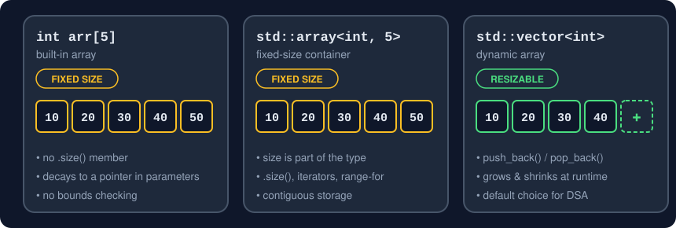


### A. Built-in array — fixed size

```cpp
int scores[5] = {85, 72, 91, 68, 88};
scores[0] = 95; // Updating an element is allowed
```

- Fixed number of elements.
- Contiguous storage and O(1) indexed access.
- No automatic resizing or `push_back()`.

### B. `std::array` — fixed-size standard-library container

```cpp
#include <array>
#include <iostream>

int main() {
    std::array<int, 5> scores{85, 72, 91, 68, 88};
    std::cout << scores[2] << '\n'; // 91
    std::cout << scores.size() << '\n'; // 5
}
```

- Fixed size that is part of its type.
- Provides `.size()`, iterators, and range-based loop support.
- Stores its elements contiguously.

### C. `std::vector` — dynamic array

For most array-based C++ DSA problems, **`std::vector` is the default choice**, unless a fixed-size array or another data structure fits better.

```cpp
#include <iostream>
#include <vector>

int main() {
    std::vector<int> values{10, 20, 30};

    values.push_back(40); // [10, 20, 30, 40]
    values.pop_back();    // [10, 20, 30]

    std::cout << values[1] << '\n'; // 20
}
```



- Can grow or shrink at runtime.
- Stores elements contiguously.
- Supports O(1) indexed access.
- Manages storage automatically.
- `push_back()` is **amortized O(1)**.

### `size()` versus `capacity()`

```cpp
std::vector<int> v{10, 20, 30};
std::cout << v.size();     // 3 elements
std::cout << v.capacity(); // at least 3; exact value varies
```

- **`size()`** is the number of elements currently in the vector.
- **`capacity()`** is how many elements fit in the current allocation before reallocation is needed.

Do not rely on a particular capacity growth factor; the C++ standard does not prescribe one.



## 4. Core array operations

### A. Traversal — visit every element

```cpp
int arr[5] = {10, 20, 30, 40, 50};

for (int i = 0; i < 5; ++i) {
    std::cout << arr[i] << ' ';
}
// Output: 10 20 30 40 50
```



**Time:** O(n) | **Auxiliary space:** O(1)

For a vector, a range-based loop is also common:

```cpp
for (int value : values) {
    std::cout << value << ' ';
}
```

### B. Access — retrieve by index

```cpp
int value = arr[2]; // 30
```



**Time:** O(1) | **Auxiliary space:** O(1)

### C. Update — replace an element

```cpp
arr[2] = 99;
// [10, 20, 99, 40, 50]
```



**Time:** O(1)

### D. Search — find a value

For an **unsorted** array, linear search checks elements one by one:

```cpp
int target = 40;
int index = -1;

for (int i = 0; i < 5; ++i) {
    if (arr[i] == target) {
        index = i;
        break;
    }
}
// If found, index stores its position; otherwise it remains -1.
```



- Best case: O(1), when the first element matches.
- Worst case: O(n), when the value is last or absent.
- Auxiliary space: O(1).

For sorted data, binary search can find a value in O(log n). Binary search is an **algorithm**, so keep its implementation in your algorithms notes.

### E. Insertion — put an element at a position

Insert `25` at index `2`:


<details>
<summary>Text version of this diagram</summary>

```text
Before: [10, 20, 30, 40, 50]
                 ↓ insert 25 at index 2
After:  [10, 20, 25, 30, 40, 50]
```

</details>

```cpp
std::vector<int> v{10, 20, 30, 40, 50};
v.insert(v.begin() + 2, 25);
```

Insertion at the beginning or middle is **O(n)** because elements may need to shift. Reallocation may also be needed. A built-in array cannot expand itself; insertion requires spare storage and manual shifting or a different container.

### F. Deletion — remove an element

Remove the element at index `2`:


<details>
<summary>Text version of this diagram</summary>

```text
                 ✕
Before: [10, 20, 30, 40, 50]
                     
After:  [10, 20, 40, 50]
```

</details>

```cpp
std::vector<int> v{10, 20, 30, 40, 50};
v.erase(v.begin() + 2);
```

- Erasing at the beginning or middle is O(n), because following elements shift left.
- Removing the final element with `pop_back()` is O(1).

**C++ detail:** `pop_back()` returns `void`; it does not return the removed value. Do not call it on an empty vector.

## 5. Time and space complexity

| Operation | Built-in fixed-size array | `std::vector` |
|---|---|---|
| Access by index | O(1) | O(1) |
| Update by index | O(1) | O(1) |
| Linear search | O(n) worst case | O(n) worst case |
| Append at end | No automatic resizing | Amortized O(1); one append can be O(n) |
| Insert at beginning/middle | Needs spare capacity and shifting | O(n) |
| Delete at beginning/middle | Needs shifting and size management | O(n) |
| Remove last element | No resizing operation | O(1) with `pop_back()` |
| Storage for n elements | O(n) | O(n) |

### Why is vector append amortized O(1)?

Most `push_back()` calls use already allocated capacity, so they are constant time. Occasionally, the vector needs a larger allocation and must move or copy its existing elements, making that individual append O(n).

Across a long sequence of appends, the average cost per append is O(1): **amortized O(1)**.



**Space versus auxiliary space**
- Storing `n` elements takes O(n) space.
- Traversing an existing array with a simple loop uses O(1) auxiliary space.
- A vector may reserve more capacity than its current size, but its storage remains O(n) relative to the number of elements.

## 6. Advantages and limitations

### ✅ Advantages
- **Fast random access:** index access is O(1).
- **Efficient traversal:** process elements in sequence.
- **Cache-friendly layout:** contiguous storage often helps CPU cache behavior.
- **Low per-element overhead:** arrays do not need a link pointer for each element.
- **Dynamic option:** `std::vector` offers resizing with array-style access.

### ⚠️ Limitations
- Built-in arrays and `std::array` have fixed sizes.
- Insertion/deletion near the beginning or middle is O(n).
- Searching unsorted data is O(n) in the worst case.
- Vector reallocation can invalidate pointers, references, and iterators to its elements.

If a vector reallocates, do not keep using pointers, references, or iterators obtained before that reallocation.



## 7. Real-world examples

### Example 1: Student marks

```cpp
std::vector<int> marks{85, 72, 91, 68, 88};
```

Use indexing to retrieve a mark and traversal to process all marks or calculate an average.

### Example 2: Monthly expenses

```cpp
std::array<double, 12> expenses{};
```

A fixed-size array suits a task that stores exactly twelve monthly values.

### Example 3: Image pixels

An image can be represented as a two-dimensional grid of pixels or color components. Real image libraries may use more specialized layouts.

### Example 4: Game board

```cpp
int board[3][3] = {
    {0, 1, 0},
    {1, 0, 1},
    {0, 0, 1}
};
```

Each row represents a row of the board, and each column represents a cell.

### Example 5: Sensor readings

```cpp
std::vector<double> temperatures{24.5, 24.8, 25.1};
temperatures.push_back(25.4);
```

A vector is useful when new measurements arrive over time.

These are illustrative uses; real systems may choose other data structures depending on their needs.

## 8. Two-dimensional arrays

A two-dimensional array is useful for grid-like data such as matrices, boards, and tables.

```cpp
int matrix[2][3] = {
    {1, 2, 3},
    {4, 5, 6}
};

std::cout << matrix[1][2]; // 6
```


<details>
<summary>Text version of this diagram</summary>

```text
             Column
             0   1   2
           +---+---+---+
Row 0      | 1 | 2 | 3 |
           +---+---+---+
Row 1      | 4 | 5 | 6 |
           +---+---+---+
```

</details>

- `matrix[0][1]` is `2`; `matrix[1][2]` is `6`.
- Built-in multidimensional arrays use **row-major order** in C++: each row's elements are contiguous, and rows follow one another.
- Valid access is O(1); traversing an `R × C` matrix takes O(R × C).
- `std::vector<std::vector<int>>` is a vector of vectors; the entire grid is not guaranteed to occupy one single contiguous block.

## 9. Passing arrays and vectors to functions

### Pass a vector by const reference when only reading

```cpp
void display(const std::vector<int>& values) {
    for (int value : values) {
        std::cout << value << ' ';
    }
}
```

`const std::vector<int>&` avoids copying the vector and prevents modification through that reference.

### Built-in array parameters

A built-in array parameter in a conventional function declaration is adjusted to a pointer parameter, so the length is not automatically preserved:

```cpp
void printArray(const int arr[], int n) {
    for (int i = 0; i < n; ++i) {
        std::cout << arr[i] << ' ';
    }
}
```

The caller supplies the length separately. For many beginner DSA problems, `std::vector<int>` is easier to pass around.

## 10. Useful C++ details

- Include `<array>`, `<vector>`, and `<iostream>` for the corresponding features.
- `v.at(i)` checks bounds and throws `std::out_of_range` for an invalid index; `v[i]` does not perform bounds checking.
- `v.push_back(x)` appends; `v.pop_back()` removes the final element and returns `void`.
- Do not call `pop_back()` on an empty vector.
- Vector reallocation can invalidate pointers, references, and iterators to its elements.
- The C++ standard does not prescribe a specific vector capacity growth factor.

## 11. When should you use an array?

Choose an array-based structure when:
- You need frequent indexed access.
- You often traverse elements.
- Your data naturally forms a sequence or grid.
- Contiguous storage is useful.
- Middle insertions and deletions are not the dominant operations.

Choose another data structure when its operations fit the problem better—for example, a hash table for average constant-time key lookup or a queue for FIFO processing.

## 12. Interview-ready recap

| Question | Short answer |
|---|---|
| Why is indexed access O(1)? | The element's location can be calculated directly. |
| Why is middle insertion O(n)? | Elements may need to shift. |
| Why is vector append amortized O(1)? | Most appends are constant time; occasional reallocation is O(n). |
| Built-in array vs `std::array`? | Both are fixed-size; `std::array` has a standard container interface. |
| `std::array` vs `std::vector`? | Fixed size versus resizable storage. |
| Why can vector references become invalid? | Reallocation can move elements to new storage. |
| Worst-case linear search? | O(n). |
| Space for n elements? | O(n). |

## 13. Final takeaway

An array stores elements in contiguous memory and provides O(1) indexed access. Searching an unsorted array takes O(n) in the worst case, while insertion or deletion near the beginning or middle usually takes O(n) because elements must shift.

In C++, choose among a built-in array, `std::array`, and `std::vector` based on whether the size is fixed or dynamic. For most array-based DSA problems, start with `std::vector`.

> **Learn the concepts once, then practise until you can implement and explain them without looking at your notes.**

## Practice checklist

- [ ] Declare, initialize, traverse, access, and update an array.
- [ ] Find a target using linear search.
- [ ] Insert and erase elements in a vector.
- [ ] Explain O(1), O(n), and amortized O(1) with examples.
- [ ] Build and traverse a two-dimensional array.
- [ ] Explain when to choose a built-in array, `std::array`, or `std::vector`.

---

**Note:** These notes are created for students learning DSA with C++. Learn, practise, and keep growing! 🚀
