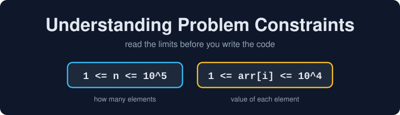

<p align="center">
  
</p>

# 📏 DSA Notes: Understanding Problem Constraints

> **For:** Students learning Data Structures and Algorithms (DSA) with C++  
> **Goal:** Read the limits of a problem correctly, then use them to choose a safe and efficient solution.

Every DSA problem comes with limits on its input. Reading them carefully is the first step of solving the problem: they tell you which inputs are valid, how fast your algorithm must be, and which data types are safe.

## Learning outcomes

By the end of this chapter, you should be able to:
- Explain what constraints are and what they tell you.
- Distinguish the size of an input (`n`) from the value of an element (`arr[i]`).
- Read inclusive (`<=`) and exclusive (`<`) bounds and powers of ten.
- Use constraints to estimate time, memory, and overflow risk.
- Follow a step-by-step routine for reading constraints before coding.

---

## 1. What are constraints?

**Constraints** are rules in a programming problem that specify the valid range or limits of the input.

They may describe:
- How many elements an input can contain
- The minimum and maximum value of each element
- The length of a string
- The number of test cases
- Limits on graph vertices and edges
- Limits on coordinates, weights, or other values

Constraints help you understand valid inputs and choose an algorithm and data types that are safe and efficient.

---

## 2. Example: array constraints

Suppose a problem states:

```text
1 <= n <= 10^5
1 <= arr[i] <= 10^4
```

These are two different constraints.

### Constraint A: `1 <= n <= 10^5`

Since `10^5 = 100000`, this means:

```text
1 <= n <= 100000
```

Here, `n` is the **number of elements** in the array.

- Minimum array size: 1 element
- Maximum array size: 100,000 elements

Examples:

```cpp
int arr1[] = {1};       // n = 1
int arr2[] = {10000};   // n = 1
```

Both arrays contain only one element. The value stored in an element does not determine the array's size.

<p align="center">
  
</p>

To declare space for 100,000 integers:

```cpp
int arr[100000];
```

This array has capacity for 100,000 elements. Its valid indices are `0` through `99999`.

### Constraint B: `1 <= arr[i] <= 10^4`

Since `10^4 = 10000`, this means:

```text
1 <= arr[i] <= 10000
```

Here, `arr[i]` represents **each individual array element**. Every element must be at least 1 and at most 10,000, inclusive.

```cpp
int a[] = {1};               // Valid values
int b[] = {1, 2, 3, 10000};  // Valid values
int c[] = {10001};           // Invalid: exceeds 10000
int d[] = {0};               // Invalid: below 1
```

<p align="center">
  
</p>

Both constraints must be satisfied. An array containing 100,000 copies of `500` satisfies both:
- `n = 100000`
- Every element is within 1 to 10,000.

An array containing 100,000 elements with values `1, 2, 3, ..., 100000` satisfies the size constraint but violates the value constraint because some elements exceed 10,000.

> **Remember:** `n` tells you how many elements there are; `arr[i]` tells you the value of one element.

---

## 3. Inclusive and exclusive bounds

The operator `<=` means “less than or equal to.” The endpoints are allowed.

For `1 <= n <= 100000`, both `n = 1` and `n = 100000` are valid.

For `1 <= arr[i] <= 10000`, both `arr[i] = 1` and `arr[i] = 10000` are valid.

If a constraint says `1 < x < 10`, the endpoints 1 and 10 are not allowed.

<p align="center">
  
</p>

---

## 4. Common mathematical notation

| Notation | Meaning |
|---|---|
| `10^3` | 1,000 |
| `10^4` | 10,000 |
| `10^5` | 100,000 |
| `10^6` | 1,000,000 |
| `1 <= x <= 100` | x is from 1 through 100, inclusive |
| `0 <= x < n` | x starts at 0 and is less than n; common index range |
| `arr[i]` | The element at index `i`; `arr[0]` is the first element in C++ |
| `n` | Often the input size; check the problem statement for its exact meaning |

<p align="center">
  
</p>

---

## 5. Why constraints matter in DSA

Constraints help answer three questions:

1. **What inputs are valid?** Avoid assumptions that contradict the stated ranges.
2. **Will my algorithm be fast enough?** Large inputs can rule out algorithms with excessive time complexity.
3. **Can my data types hold the result?** Sums, products, and intermediate calculations can exceed the input values.

Constraints are part of the problem specification, not just extra documentation.

---

## 6. Using constraints to estimate algorithm efficiency

These are rough guidelines, not guarantees. Feasibility depends on time limits, language, implementation, and operation costs.

| Input size | Approaches to investigate |
|---|---|
| `n <= 10` | Some exponential or factorial approaches may be feasible |
| `n <= 20` | Bitmasking or some `O(2^n)` approaches may be feasible |
| `n <= 100` | `O(n^3)` may be feasible in some settings |
| `n <= 1000` | `O(n^2)` may be feasible in some settings |
| `n <= 10^5` | `O(n log n)` or `O(n)` is often a good target |
| `n <= 10^6` | `O(n)` is often preferable; account for memory and constants |
| `n` around `10^9` | An `O(n)` loop is usually impractical; look for mathematical or sublinear approaches |

Use these as starting points, not rigid rules. Multiple test cases, expensive operations, memory limits, and constant factors can change what is feasible.

### Counting the work

A common rough rule of thumb is that about `10^8` simple operations fit in roughly a second, though this varies a lot with the machine, the language, and what each operation does. Comparing the operation count with that budget shows why the table above looks the way it does.

For `n = 100000`:
- `O(n)` is about `10^5` operations.
- `O(n log n)` is about `1.7 × 10^6` operations (since `log2(100000)` is about 16.6).
- `O(n^2)` is `10^10` operations, far above the rough budget.

<p align="center">
  
</p>

### Example: summing an array

```cpp
long long sum = 0;

for (int i = 0; i < n; ++i) {
    sum += arr[i];
}
```

- Time complexity: `O(n)`
- Auxiliary space complexity: `O(1)`

For `n = 100000`, this performs 100,000 additions and is normally efficient.

For an arbitrary array, you generally cannot use `n * (n + 1) / 2` to find its sum. That formula applies to the consecutive integers from 1 through `n`.

---

## 7. Constraints and integer overflow

The **input values** may fit in an `int`, while the **result** may not.

For:

```text
1 <= n <= 100000
1 <= arr[i] <= 10000
```

the maximum possible sum is:

```text
100000 * 10000 = 1000000000 = 10^9
```

A typical 32-bit signed C++ `int` has a maximum value of `2,147,483,647`, so this sum fits in such an `int`.

<p align="center">
  
</p>

Always check the limits of the type and all intermediate calculations. If values or products can be larger, consider `long long`.

```cpp
long long product = 1LL * a * b;
```

The `1LL` makes the multiplication happen as `long long`, helping avoid overflow that could occur if `a * b` were evaluated as an `int` first.

---

## 8. Constraints and memory usage

If an array contains `n` elements and each element occupies `s` bytes, its element storage is approximately:

```text
Memory = n * s bytes
```

If a typical `int` occupies 4 bytes:

```text
100000 * 4 = 400000 bytes
```

That is about 400 KB in decimal units, or about 390.6 KiB.

<p align="center">
  
</p>

This estimate excludes other overhead. Very large local arrays can exceed stack limits in C++; dynamic allocation or `std::vector` may be more suitable.

---

## 9. Different kinds of constraints

<p align="center">
  
</p>

### Array size and values

```text
1 <= n <= 100000
-100000 <= arr[i] <= 100000
```

The first line limits the number of elements. The second limits each element's value; negative values are allowed.

### String length

```text
1 <= s.length() <= 100000
```

The string has between 1 and 100,000 characters, subject to the problem's definition of character and string representation.

### Number of test cases

```text
1 <= t <= 100
```

The program handles between 1 and 100 test cases. If every test case has `n` elements, consider the total work across all test cases, not just one.

### Graphs

```text
1 <= V <= 100000
0 <= E <= 200000
```

Here `V` is the number of vertices and `E` is the number of edges. These limits help guide choices such as adjacency lists versus adjacency matrices.

### Coordinates or weights

```text
-10^9 <= x <= 10^9
```

The value can be negative or positive. Differences, products, and squared distances can be much larger than the input values.

---

## 10. A reliable process for reading constraints

Before coding:

1. Identify what each variable means in the statement.
2. Convert powers of ten into ordinary numbers when helpful.
3. Separate input size limits from individual value limits.
4. Check whether bounds are inclusive (`<=`) or exclusive (`<`).
5. Determine whether values may be negative or zero.
6. Estimate the largest possible result and intermediate calculations.
7. Consider the total input across all test cases.
8. Choose an algorithm based on time and memory limits.
9. Verify the smallest and largest permitted inputs.

<p align="center">
  
</p>

---

## 11. Common mistakes

<p align="center">
  
</p>

- **Mistake:** `arr[] = {100000}` means `n = 100000`.
  - **Correction:** It contains one element, so `n = 1`.

- **Mistake:** If `n <= 100000`, every element can be as large as 100000.
  - **Correction:** A separate value constraint may cap elements at 10000.

- **Mistake:** Valid input guarantees the result fits in `int`.
  - **Correction:** Check the result and intermediate values separately.

- **Mistake:** The biggest allowed input always requires the same algorithm.
  - **Correction:** Consider the time limit, memory limit, test cases, and operation costs.

- **Mistake:** `O(n^2)` is always too slow when `n = 100000`.
  - **Correction:** It is usually a warning sign, but estimate the actual work and consider the environment.

---

## 12. Interview-ready summary

**Constraints specify the permitted input ranges and limits of a programming problem.** They tell us how large an input can be, how small or large its values can be, and sometimes how many test cases or graph edges may exist. We use constraints to verify input validity, choose an appropriate algorithm, estimate time and memory usage, and prevent integer overflow.

For the example:

```text
1 <= n <= 10^5
1 <= arr[i] <= 10^4
```

- The array contains between 1 and 100,000 elements.
- Every element is between 1 and 10,000.
- Both conditions must hold for the input to be valid.

| Question | Short answer |
|---|---|
| What is `n`? | The number of elements (or input size), not the value of any element. |
| What is `arr[i]`? | The value stored at index `i`. |
| Is `<=` inclusive? | Yes. Both endpoints are allowed; `<` excludes them. |
| Why read constraints first? | They guide the algorithm, the data types, and the memory plan. |
| When might `int` overflow? | When a sum or product can exceed about 2.1 × 10^9. |
| Rough target for `n <= 10^5`? | `O(n log n)` or `O(n)`. |
| Memory for `10^5` ints? | About 400 KB (100,000 × 4 bytes). |

---

## Practice checklist

- [ ] Rewrite three constraint lines in ordinary numbers (for example, `10^5` as 100000).
- [ ] For a given pair of constraints, say which one limits the size and which limits the values.
- [ ] Decide whether a given input is valid, including the endpoints.
- [ ] Estimate the largest possible sum and choose `int` or `long long`.
- [ ] Choose a target time complexity from `n` and justify it.
- [ ] Estimate the memory of an array of `n` elements.
- [ ] Walk through the nine-step routine on a problem you have solved before.
